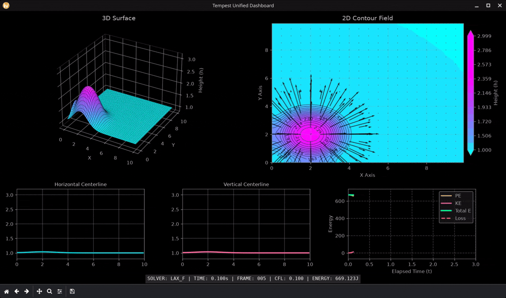
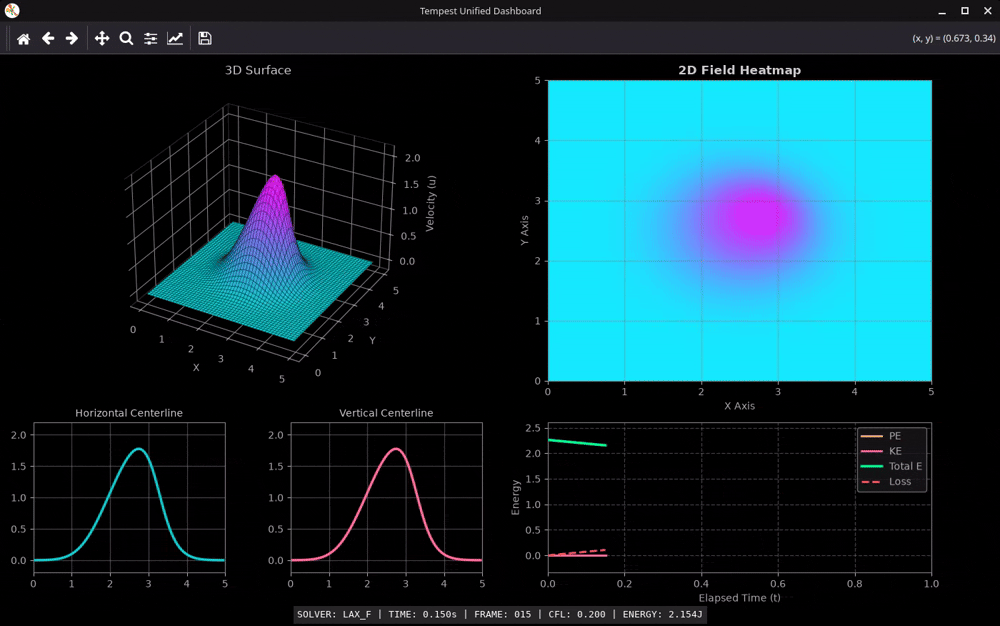
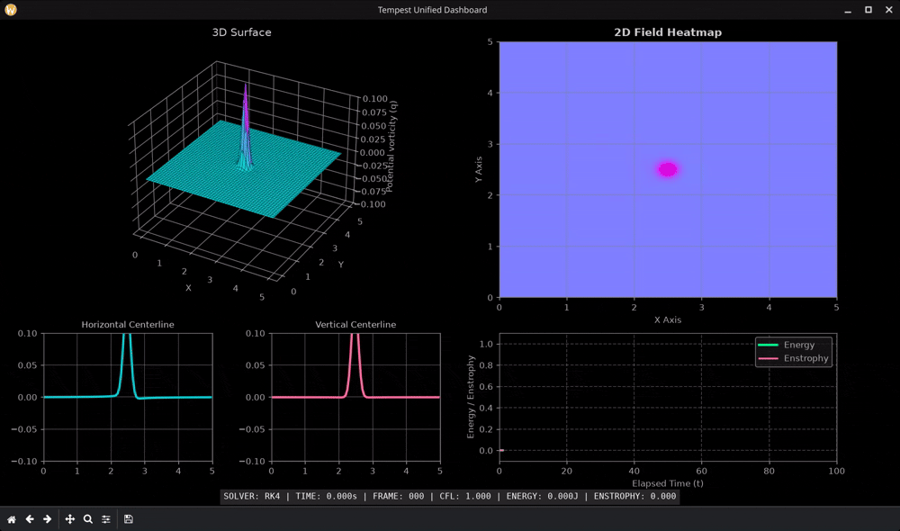

# Tempest

### A computational physics laboratory for studying **numerical and learned methods for partial differential equations**.

Tempest is a record of that work: explicit finite-difference schemes for a few textbook PDEs, and experiments on learning a time step from the fields those schemes produced.

> **Status:** Not currently active. Tempest is where I explored numerical
> methods for PDEs and learned surrogate solvers. I’m keeping it here as a record of that
> work.

## What It Explores

The central question is:

> **How do different computational approximations reproduce the dynamics of
> physical systems described by PDEs?**

The repository experiments with both conventional numerical methods and
scientific machine-learning approaches.

## Example Simulations

### Shallow Water Equations



Gravity-wave and dam-break dynamics.

### Burgers' Equation



Non-linear shock formation.

### Rossby Wave Equation



Planetary-wave propagation from the β-effect.

## Implemented Methods

### Implemented physical models include:

* advection and diffusion
* wave and Burgers' equations
* shallow-water dynamics
* Rossby-wave dynamics
* barotropic vorticity

### Numerical methods include:

* Euler and RK4
* Leapfrog
* Upwind, central-difference, Lax-Friedrichs, and Lax-Wendroff schemes
* finite-difference spatial operators

## Learned Solvers

Tempest also contains experimental work on learned approximations to PDE
evolution, including:

* CNN surrogates
* spectral surrogates
* basic Fourier Neural Operators
* autoregressive long-horizon prediction
* generalization across unseen initial conditions

The learned models were trained on trajectories this solver had already written out. They are 1D next-step maps: a convolutional kernel for advection, a small spectral network, and a 1D Fourier neural operator. One-step error was often small. Closed-loop rollouts accumulated error, and the spectral model failed on translated initial conditions.

See [`CNN Surrogate`](docs/CNN_surrogate.md), [`Spectral Surrogate`](docs/spectral_surrogate.md), and [`FNO rollout instability`](docs/fno_rollout_instability.md).


## Validation

Numerical methods are compared against analytical solutions where available,
with supporting:

* convergence studies
* error analysis
* stability diagnostics
* energy diagnostics

See [`Validation Study`](docs/validation_study_final.md) and
[`Burgers Validation`](docs/burgers_validation.md).

## Architecture

Simulations are assembled from interchangeable:

```text
Governing equation
       │
       ▼
Spatial discretization
       │
       ▼
Time integrator
       │
       ▼
Boundary / initial conditions
       │
       ▼
Diagnostics
```

Each run is a Python config: grid, initial condition, boundary, spatial operator, equation, and time integrator.

## Reproducing a Run

>`requirements.txt` is a frozen environment from the machine used here, not a supported install.

```bash
git clone https://github.com/h-livv/tempest.git
cd tempest
pip install -r requirements.txt

python main.py configs/2d/advection/simulation.py
```

## Notes

The validation studies cover specific equations and setups; they are not a
general guarantee for every method in the repository. The learned solvers were
early experiments, and long-horizon stability remained a challenge.
